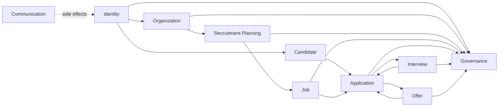

# Business Domain Map

**Status:** APPROVED  
**Last updated:** 2026-10-05  
**Source:** `AGENTS.md` §§6-8, 16-17, 35-36

## 1. Domain overview

Arrows indicate information or workflow dependencies, not permission to mutate another
domain's persistence.

## 2. Ownership map

| Domain | Owns | Must not own/decide |
|---|---|---|
| Identity | User identity, credentials, authentication, sessions, platform identity data | Organization-specific recruitment authorization |
| Organization | Organization, membership, fixed organization roles, role-derived permissions, tenant boundary, and recruitment-resource assignments | Candidate/application lifecycle decisions or implicit recruitment-content access for Organization Admin |
| Recruitment Planning | Recruitment requests, hiring needs, requested headcount, approvals, request lifecycle | Job/application private persistence |
| Candidate | Candidate profile, skills, experience, education, resume versions, preferences | Application lifecycle/history |
| Job | Job opening, description, requirements, publication, job lifecycle | Application lifecycle/history |
| Application | Application record, snapshot, screening, pipeline, rejection information, history | Private Interview persistence or Candidate profile mutation |
| Interview | Interview process, rounds, scheduling, assignments, feedback, scorecards, interview lifecycle | Candidate profile or Application persistence mutation |
| Offer | Offer content, approval, sending, response, offer lifecycle, hiring-related outcome behavior | Candidate profile mutation |
| Communication | Notification delivery, email, templates, delivery history | Recruitment decisions |
| Governance | Audit, activity history, security events, traceability metadata | Primary recruitment workflow ownership |

## 3. Required collaboration boundaries

| Collaboration | Required information | Ownership constraint |
|---|---|---|
| Identity -> Organization | Authenticated User identity | Organization owns membership/roles/permissions |
| Recruitment Planning -> Job | Approved recruitment context and position requirements | Recruitment Planning retains request/approval history; Job owns job lifecycle |
| Candidate + Job -> Application | Candidate identity/snapshot and target job | Application owns the submitted record and lifecycle |
| Application -> Interview | Authorized request to begin interview activity | Interview owns scheduling/feedback; Application owns pipeline state |
| Interview -> Application | Interview outcome/reference | Interview must not directly update Application persistence |
| Application -> Offer | Authorized request to begin offer activity | Offer owns offer lifecycle; Application owns pipeline state |
| Offer -> Application | Accepted/declined/withdrawn outcome reference | Exact hiring-completion coordination remains unresolved |
| Any business domain -> Communication | Committed event and recipient/context | Communication only delivers; it does not decide outcomes |
| Any critical domain -> Governance | Actor/action/target/organization/correlation metadata | Governance owns the durable audit record |

Candidate identity remains independent of Organization Membership. The same User may
participate as Candidate and as staff in different organizations, but those authority
contexts do not inherit access from one another.

## 4. Cross-domain invariants

| Rule ID | Invariant |
|---|---|
| `BR-DOM-001`, `BR-DOM-002` | A domain owns its data; cross-domain mutation requires an explicitly approved operation. |
| `BR-APP-001`, `BR-APP-002` | Application remains independent from Job and Candidate ownership. |
| `BR-CAN-005`, `BR-APP-006` | Candidate profile updates do not rewrite Application snapshots. |
| `BR-INT-006` | Interview does not modify Candidate profile records. |
| `BR-NOT-002` | Communication does not reject, shortlist, approve, hire, or otherwise decide. |
| `BR-AUTH-005`, `BR-ORG-002` | Cross-domain workflows preserve authorization and organization scope. |
| `BR-AUTH-008`–`012`, `BR-ORG-005`–`008` | Role/Tenant isolation, assignment scope, fixed role composition, and administrator content boundaries follow the approved Role/Tenant baseline. |

External side-effect atomicity is an engineering constraint from `AGENTS.md` §34; it
is not represented here as a new product rule.

## 5. Approved Role/Tenant ownership boundaries

- Each private recruitment resource belongs to exactly one Organization.
- Initial scope has no organization hierarchy, inherited tenant permissions, or
  cross-organization shared recruitment resources.
- Organization owns membership, fixed-role composition, role-derived permissions,
  and recruitment assignments; it does not own recruitment lifecycle decisions.
- Recruitment domains enforce both tenant ownership and assignment/broad-scope
  permission when exposing private resources.
- Organization Admin owns administration of membership/configuration but receives no
  recruitment-content access without an additional business role.
- Platform Admin owns platform/control administration but receives no tenant
  recruitment-content access and does not perform routine recruitment assignment.
- Privileged-role changes and recruitment reassignment collaborate with Governance for
  audit records; audit ownership does not transfer the business decision.

These boundaries are approved by `P1-OD-003`, `004`, `009`–`014`, and `023`.

## 6. Open domain decisions

| ID | Decision needed |
|---|---|
| P1-OD-015 | Is Recruitment Need a separate aggregate or descriptive input to Recruitment Request? |
| P1-OD-016 | What cardinality connects Recruitment Request to Job? |
| P1-OD-017 | Which Application snapshot fields are mandatory? |
| P1-OD-018 | Does Application own the final `HIRED` state, or is there a separate hire/onboarding record? |
| P1-OD-019 | How are Interview results represented to Application without cross-domain mutation? |
| P1-OD-020 | How are Offer outcomes coordinated with Application and requested headcount? |
| P1-OD-021 | Which cross-domain collaborations are synchronous commands versus events? |

