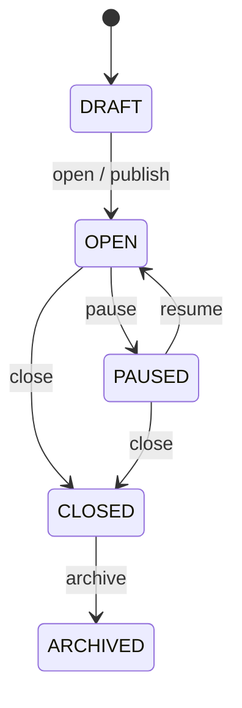

# Job Lifecycle

**Status:** APPROVED  
**Last updated:** 2026-10-05  
**Owning domain:** Job  
**Source:** `AGENTS.md` §§11, 15, 41

## 1. Statuses

- `DRAFT`
- `OPEN`
- `PAUSED`
- `CLOSED`
- `ARCHIVED`

## 2. Explicitly defined transitions

| From | Operation | To |
|---|---|---|
| `DRAFT` | Open/publish job | `OPEN` |
| `OPEN` | Pause job | `PAUSED` |
| `PAUSED` | Reopen/resume job | `OPEN` |
| `OPEN` | Close job | `CLOSED` |
| `PAUSED` | Close job | `CLOSED` |
| `CLOSED` | Archive job | `ARCHIVED` |

No other transition is approved by the current source.

## 3. Transition diagram

## 4. Known invariants

`P1-OD-024` prohibits generic reopen, force-status, terminal-state reversal, and
Platform Admin lifecycle bypass. A correction requires a separately approved audited
use case with an explicit transition.

| Rule ID | Invariant |
|---|---|
| `BR-JOB-002` | Only the source-defined transitions in this document are currently defined. |
| `BR-JOB-003` | `CLOSED` and `ARCHIVED` jobs reject new applications unless a future approved exception exists. |
| `BR-JOB-004` | Lifecycle changes are named operations, not unrestricted status updates. |
| `BR-JOB-005` | Every transition validates state, operation, actor, permissions, and applicable rules. |

### Approved Role/Tenant authorization baseline

Each private Job resource belongs to one Organization. Recruiter/Hiring Manager access
is assignment-scoped unless an explicit role-derived organization-wide recruitment
permission applies. Organization Admin requires an additional recruitment business
role, and Platform Admin has no Job-content authority. See `BR-ORG-005`,
`BR-ORG-007`, and `BR-ORG-008`.

## 5. Approved transition controls

Every transition requires an assigned `RECRUITER` with `PERM-JOB-MANAGE`, or an
explicit role-derived organization-wide management scope, matching Organization and a
recruitment owner. Each invalid current state, tenant/assignment mismatch, or
unauthorized request is rejected; no caller supplies arbitrary status.

| Transition | Preconditions | Audit |
|---|---|---|
| `DRAFT → OPEN` | Valid Job; immediate internal/public publication only; linked Request is approved where present | publish |
| `OPEN → PAUSED`, `PAUSED → OPEN` | Authorized operational action | pause/resume |
| `OPEN/PAUSED → CLOSED` | Authorized closure; existing Applications continue under Application rules | close |
| `CLOSED → ARCHIVED` | Authorized archival | archive |

`OPEN` alone accepts new Applications. `CLOSED` and `ARCHIVED` do not reopen; a new
linked Job is required. A linked Job shares the Request's enforced headcount; external
channels/scheduling are out of scope.

## 6. Resolved lifecycle decisions

| ID | Decision needed |
|---|---|
| P1-OD-032 | Who may perform each transition and whether ownership/assignment is required |
| P1-OD-033 | Whether `OPEN` means internally open, publicly published, or both |
| P1-OD-034 | Publication scheduling, unpublishing, and external channel behavior |
| P1-OD-035 | Whether a `CLOSED` or `ARCHIVED` job can ever be restored |
| P1-OD-036 | What happens to active applications when a job is paused or closed |
| P1-OD-037 | Whether job capacity is constrained by Recruitment Request headcount |

Resolved by `P1-OD-032`–`037`; see [`P1_APPROVAL_DECISIONS.md`](../P1_APPROVAL_DECISIONS.md).

